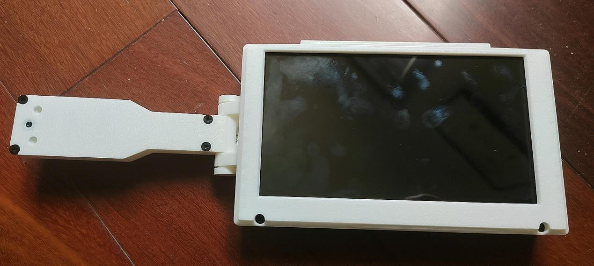
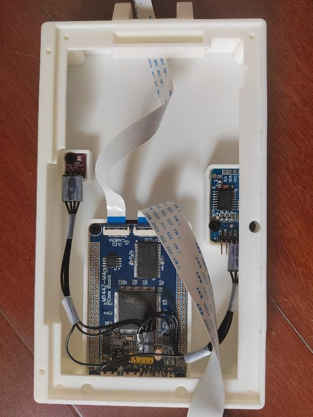
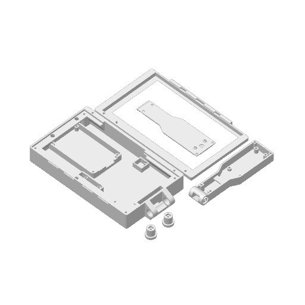

# 家用物品信息终端 · Smart Reminder

基于 **STM32F407、7 寸触摸屏和 OV2640 摄像头**的家用物品登记终端。拍照后手动填写物品信息，在屏幕上查询、编辑，并通过颜色和剩余时间查看有效期状态。

作者：**江沛宸 Jiang Peichen / Inseven**。本仓库整理自 2026 年 7 月 4 日保留版本，包含固件源码、预编译 HEX、3D 打印工程、TF 卡资源与制作说明。



## 功能

- 摄像头拍照，手动录入名称与备注、数量、剩余有效时长。
- 物品浏览、名称搜索排序、编辑，以及回收站删除与恢复。
- 有效期提醒页：颜色、进度、剩余时间和过期状态筛选。
- 物品数据保存在外部 NOR Flash，源码包含双区域交替保存、版本号和 CRC32 校验，以及 TF 卡备份恢复流程。
- 触摸操作、中文输入和显示、JPEG 照片保存与显示。
- 辅助功能包括时钟、抽签、温湿度/气压及海拔显示、表达式计算。

**当前版本没有自动物品识别、存放位置查询、闹钟和定时器；有效期提醒不会主动弹窗或发声。** 这些功能中部分曾做过尝试，后来依据实际使用效果删减。

## 目录

```text
firmware/
  source/                         STM32 C/HAL 源码与 Keil 工程
    MDK-ARM/smart_remd.uvprojx     工程入口
  prebuilt/-O2/smart_remd.hex      原项目保留的 HEX
  prebuilt/-O3/smart_remd.hex      原项目保留的 HEX
hardware/3d/all.3mf               外壳与连接件打印工程
sdcard/smart_remd_stat/           中文字库与 Unicode/GBK 编码表
docs/硬件清单与安装.pdf            原版制作说明与装配照片
docs/BUILD_AND_ASSEMBLY.md         当前仓库路径、编译和装配指引
docs/images/                     实物与打印模型预览
LICENSE                          作者自有内容的 MIT 许可证
LICENSES/                        第三方许可证文本
THIRD_PARTY_NOTICES.md            第三方组件和资源说明
```

## 硬件

| 部件 | 原项目配置 |
| --- | --- |
| 主控板 | 正点原子 STM32F407ZGT6 最小系统板，带外部 NOR Flash 与扩展 SRAM |
| 屏幕 | 正点原子 7 寸 V3 TFT，800×480，MCU 接口、电容触摸 |
| 摄像头 | OV2640，无 FIFO 模块及转接板 |
| 时钟 | DS3231 / AT24C32 模块，带电池 |
| 环境传感器 | BME280 模块，用于温湿度和气压相关显示 |
| 存储与结构 | TF 卡、连接排线、3D 打印外壳与连接件、M3 螺丝 |

这版使用购买的开发板和模块连接，没有单独设计整机 PCB。模块版本、排线方向和安装方式请对照[原版制作说明](docs/硬件清单与安装.pdf)；其中采购截图与价格是项目当时的参考信息。

## 开始制作

1. 阅读[制作、编译与装配指南](docs/BUILD_AND_ASSEMBLY.md)和[原版说明 PDF](docs/硬件清单与安装.pdf)。
2. 按说明准备硬件，打印 [all.3mf](hardware/3d/all.3mf) 中的外壳及连接件。
3. 如需修改代码，使用 Keil µVision 打开 [`smart_remd.uvprojx`](firmware/source/MDK-ARM/smart_remd.uvprojx)。历史工程记录使用 ARMCC 5.06 update 7、STM32F4xx DFP 2.15.0。
4. 若直接使用历史固件，按硬件匹配情况选择 [HEX 文件](firmware/prebuilt/)。仓库同时保留 `-O2` 和 `-O3` 两个目录，未宣称两者的性能差异已重新测试。
5. 使用空白 TF 卡，将 [`sdcard/smart_remd_stat/`](sdcard/smart_remd_stat/) 放到卡根目录，按说明完成首次初始化和字库写入，再设置时间、校准/检查触摸及测试基本流程。

源码同时有 UTF-8 和 GB18030 编码文件，发布时保留原字节；编辑时请识别原文件编码，避免中文字串乱码。

## 实物与结构

项目已制作成实物，并由作者确认在家中使用。照片来自原项目制作说明，显示内部装配和组装结果。

| 内部连接 | 打印件预览 |
| --- | --- |
|  |  |

## 版本与验证范围

- **2026-05-19**：早期发布阶段。
- **2026-07-04**：本仓库采用的保留版本；设置页中的版本字符串仍为 `260519`，未为这次发布改动业务源码。
- **2026-10-20**：整理为公开仓库，补充目录说明与许可证，排除本机界面配置、编译列表、安装包等无关文件。

本次公开整理检查了源码工程引用、文件完整性与发布清单，没有重新编译、刷写或逐项进行硬件验收。预编译 HEX 按历史文件原样提供，未声明可以由当前环境逐字节复现。双区域保存、CRC 和备份恢复等属于现有实现，其断电可靠性、容量边界和长期稳定性未在本次发布中重新测试。

## 许可证与致谢

作者拥有版权的代码、文档与模型按 [MIT](LICENSE) 提供。STMicroelectronics HAL/设备文件、Arm CMSIS 和 FatFs 保留各自版权与许可证，详见 [THIRD_PARTY_NOTICES.md](THIRD_PARTY_NOTICES.md)。随附字库和编码资源按原始项目文件提供，未将其重新标为 MIT。

感谢 STMicroelectronics、Arm、FatFs 及相关硬件和工具作者。
