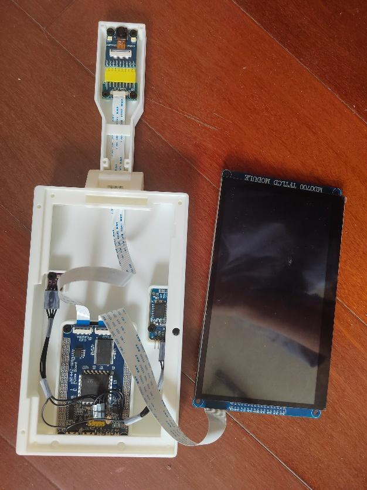

# 制作、编译与装配

本文整理自项目原版说明，并补充本仓库内的文件位置。硬件照片与原始步骤见[硬件清单与安装.pdf](硬件清单与安装.pdf)。

## 1. 准备文件和工具

| 用途 | 仓库内位置 |
| --- | --- |
| Keil 工程 | [`firmware/source/MDK-ARM/smart_remd.uvprojx`](../firmware/source/MDK-ARM/smart_remd.uvprojx) |
| 预编译固件 | [`firmware/prebuilt/`](../firmware/prebuilt/) |
| 打印工程 | [`hardware/3d/all.3mf`](../hardware/3d/all.3mf) |
| TF 卡初始化资源 | [`sdcard/smart_remd_stat/`](../sdcard/smart_remd_stat/) |

原版说明使用“代码文件”“HEX代码文件”“TF卡需要的文件”等旧目录名，在本仓库分别对应上述位置。开发、烧录、切片软件、驱动和软件安装包不随仓库分发。

历史工程记录的开发环境是 Keil µVision / ARMCC 5.06 update 7，器件为 STM32F407ZGTx，器件包为 `Keil.STM32F4xx_DFP.2.15.0`。工程自带使用的 HAL/CMSIS 源码，仍需本机具备相应编译器与器件支持。首次打开时如提示缺少组件，应在自己的开发环境补齐对应组件；本仓库未提供或保证其他编译器的直接兼容。

## 2. 组装硬件

1. 对照原版说明选取主控板、屏幕、摄像头、时钟与传感器模块，确认各模块版本及排针方向。
2. 按说明焊接 BME280 排针；OV2640 模块背面 R2 位置的处理仅适用于说明中对应的无 FIFO 模块，不对不同型号直接套用。
3. 打印 `all.3mf` 中的外壳与连接件，拆除支撑并清理毛刺。原说明建议白色 PETG，按实际打印机与材料调整参数。
4. 原版说明中，外部时钟和传感器的共用连接为：SCL → PA9，SDA → PA10，VIN/VCC → 3V，GND → GND。以说明中的模块实物和引脚标注核对。
5. 使用对应排线连接摄像头、屏幕和开发板，确认同面/异面排线与接口方向。
6. 先核对连接并完成初始化，再将电路板和模块固定进打印外壳，装配结构参考原版说明第 6 页。



## 3. 编译或使用已有固件

打开 `firmware/source/MDK-ARM/smart_remd.uvprojx`，确认所用编译器、器件包、下载器及 Flash 配置后构建。`.ioc` 作为原项目配置保留，实际发布工程以现有 Keil 工程和源码为准；重新生成代码前应另存副本，避免覆盖手写的驱动和应用实现。

不修改源码时，也可以使用 `firmware/prebuilt/-O2/smart_remd.hex` 或 `-O3/smart_remd.hex`。两者均是原项目保留产物，本次未重新烧录比较。按原说明，可使用板卡支持的串口下载方式或仿真器完成烧录。

Keil 的界面布局、个人调试选项和编译列表未纳入公开版。首次使用请自行选择匹配的下载器，不依赖作者电脑上的调试配置。

## 4. TF 卡资源与首次初始化

使用一张**不含需要保留数据的空白 TF 卡**。原项目说明建议 4–32 GB，示例为 8 GB。程序在未识别到文件系统时包含 FAT32 格式化路径，不要使用存有重要文件的卡直接尝试。

将 `sdcard/smart_remd_stat` 整个目录复制到 TF 卡根目录，形成：

```text
smart_remd_stat/
  GBK12.FON
  GBK16.FON
  GBK24.FON
  UNIGBK.BIN
```

原版说明的首次流程是：烧录后插卡启动，按提示操作；若卡由设备初始化，在显示 `Start chinese fonts rewrite` 时断电，将卡接入电脑并复制上述文件，再插回设备重新启动。确保资源复制完成后再让字库写入过程继续；正常字库写入时不要中断供电。仓库未更改原固件的初始化行为。

照片与数据库备份会写入同一 `smart_remd_stat` 目录；仓库只包含初始化所需的四个文件，不含任何家庭物品记录、真实用户照片或运行数据库。

## 5. 基本使用检查

1. 首次启动按界面提示设置系统日期、时间，并检查触摸操作。
2. 拍照，输入物品名称/备注、数量和剩余有效时长，保存。
3. 在主页查询、编辑记录，检查照片与文字显示。
4. 在提醒页查看颜色、进度、剩余时间和过期筛选。
5. 按需检查删除/恢复、备份与辅助功能；重要数据另行保留副本。

这些是制作后的检查建议，本次公开整理没有在实物上执行。提醒功能为屏幕页面显示，没有主动弹窗或声音；当前版本没有自动识别、存放位置、闹钟和定时器。
